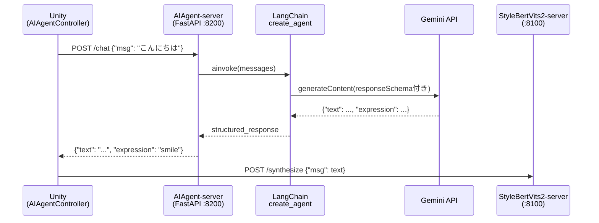

# AIAgent-server

Unity(Live2D)から送られたテキストを受け取り、LLM(Gemini)の応答を返すサーバーです。
FastAPI + LangChain(v1) の `create_agent` で実装しています。

いまは「1回聞いて1回返す」だけの最小構成ですが、**メモリ・セッション管理・Redis・RAG・ツール・複数エージェントの協調などへ広げていくための土台**として作っています。
「拡張のヒント」を参考に、アイデアを試してみてください。

## 目次
- [なぜLangChain(LangGraph)か](#なぜlangchainlanggraphか)
- [構成](#構成)
- [起動](#起動)
- [API](#api)
- [Unity側](#unity側)
- [拡張のヒント](#拡張のヒント)
- [注意事項](#注意事項)

## なぜLangChain(LangGraph)か

特定の目的(RAGならLlamaIndex、Google CloudならADKなど)がない状態で、**どの方向にも広げやすい**ものとして選んでいます。

- メモリ・Redis・RAG・ツール・MCP・複数エージェントのどれにも、公式の部品や連携パッケージがある
- LangChain v1の`create_agent`はLangGraphの上に作られているため、複雑な流れが必要になったらLangGraphへそのまま進める
- 利用者・書籍・記事が多く、調べやすい
- `init_chat_model`でモデルを後から替えられる(ベンダーに縛られない)

ほかの選択肢: Google ADK(Google Cloudとの連携が強い)、Pydantic AI(型を重視・軽量)、OpenAI Agents SDK、CrewAIなど。同じサーバーを別のフレームワークで作り直して比べてみるのも、良い題材になります。


## 構成



| ファイル | 役割 |
|---|---|
| `server/main.py` | FastAPIのエンドポイント(`/chat`, `/health`) |
| `server/agent.py` | **エージェントの組み立て。拡張するときに主に触るファイル** |
| `server/config.py` | 設定(`.env`・環境変数から読み込む) |

## 起動

```bash
cp .env.example .env
# .env の GOOGLE_API_KEY に、Google AI Studio で発行したAPIキーを設定する
docker compose up --build
```

Dockerを使わない場合:

```bash
python3 -m venv .venv
.venv/bin/pip install -r server/requirements.txt
cd server && ../.venv/bin/uvicorn main:app --port 8200 --reload
```

動作確認:

```bash
curl http://localhost:8200/health
curl -X POST http://localhost:8200/chat \
  -H "Content-Type: application/json" \
  -d '{"msg": "こんにちは"}'
```

### 設定項目(`.env`)

| 項目 | 既定値 | 意味 |
|---|---|---|
| `GOOGLE_API_KEY` | (空) | Gemini APIキー |
| `MODEL` | `google_genai:gemini-3.5-flash-lite` | `プロバイダ:モデル名`。LangChainの`init_chat_model`に渡す |
| `TEMPERATURE` | `0.7` | 応答のランダムさ |

## API

### `POST /chat`

| | 内容 |
|---|---|
| リクエスト | `{"msg": "ユーザーの発話"}` |
| レスポンス(200) | `{"text": "セリフ本文", "expression": "normal" \| "smile"}` |
| 400 | `msg`が空 |
| 502 | LLM側のエラー(APIキー不正・レート制限など)。`detail`に理由が入る |

### `GET /health`

`{"status": "ok", "model": "...", "api_key_configured": true}`

## Unity側

`Assets/AIAgentController.cs` を使います。`LLMController.cs`(Gemini APIを直接呼ぶ版)と同じ公開API(`SubmitUserText` / `OnSendButtonClicked` / `OnResponseText` / `IsBusy`)を持っています。

- APIキー・システムプロンプト・出力スキーマはサーバー側で持つため、Unity側には持たせません(ビルドしたアプリにAPIキーが含まれない)。
- Inspectorの`Server Url`で接続先を変えられます(既定: `http://localhost:8200/chat`)。

## 拡張のヒント

`server/agent.py` の `create_agent(...)` の各引数が、そのまま拡張ポイントになっています。

```python
return create_agent(
    model=model,                              # ← モデルを替える
    system_prompt=SYSTEM_PROMPT,              # ← キャラクター設定
    response_format=ProviderStrategy(LLMOutput),  # ← 出力の形(表情・感情・モーションなど)
    tools=[],            # ← 関数ツール / RAG / MCP
    middleware=[],       # ← ガードレール / 要約 / 承認
    checkpointer=None,   # ← 会話メモリ
    store=None,          # ← 長期記憶
)
```

> パッケージ名やクラス名はバージョンで変わることがあります。試すときは公式ドキュメントで確認してください。

## 注意事項

- `.env`(APIキー)はGitにコミットしないでください(`.gitignore`済み)。
- Unityから`http://`(非HTTPS)で接続するため、Unityの`Player Settings > Allow downloads over HTTP`を許可する必要があります(StyleBertVits2-serverと同じ)。
- Gemini APIの無料枠にはレート制限があります。制限に達すると`/chat`は502を返します。
